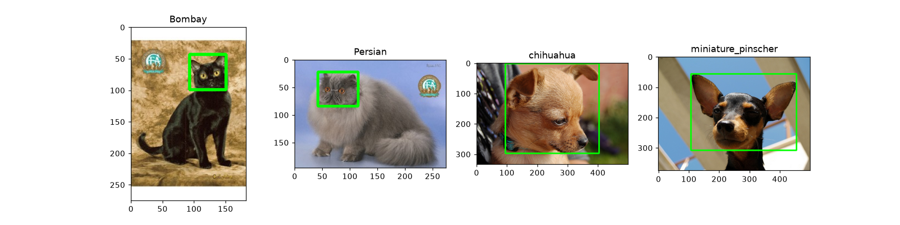

# Лабораторная 1: Среда, репозиторий и первый взгляд на данные

## 1. Задача

Прочитать изображения своего варианта как массивы и собрать сводку по файлам и разметке.

## 2. Как запустить

Локально. Перед Run All ничего менять не нужно.

## 3. Данные

Вариант 17: Bombay, Persian, chihuahua, miniature_pinscher.

## 4. Результаты

| Что | Значение |
| --- | --: |
| n_files | 800 |
| n_breeds | 4 |
| n_cats | 400 |
| n_dogs | 400 |
| width_min | 114 |
| width_median | 375 |
| width_max | 1725 |
| height_min | 103 |
| height_median | 333 |
| height_max | 1600 |
| n_not_rgb | 0 |
| n_jpg_not_jpeg | 0 |
| n_with_xml | 400 |

## 5. Выводы

- Не в RGB 0 файлов из 800, `.jpg` не JPEG тоже 0: приводить режимы не нужно.
- Ширина от 114 до 1725, высота от 103 до 1600: `cv2.resize(img, (224, 224))` растянет самые маленькие кадры примерно в 2 раза, самые большие сожмёт в 7–8 раз, пропорции не сохраняются.
- Бокс головы есть у 400 из 800 изображений, то есть у 50%.
